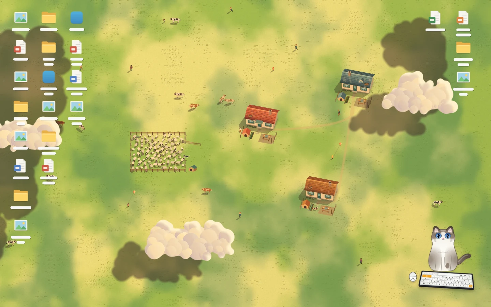
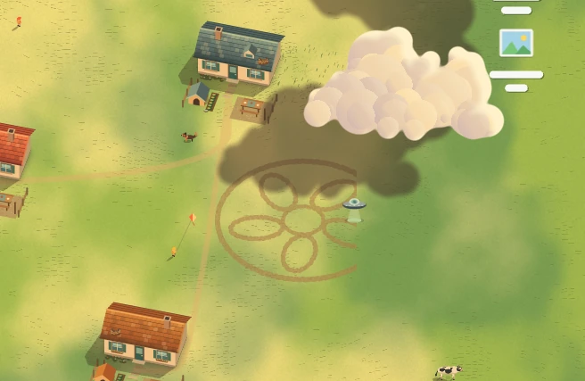
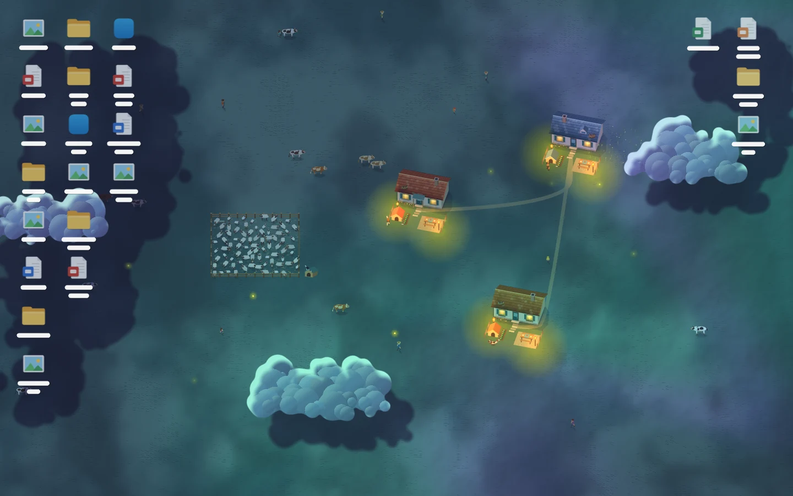
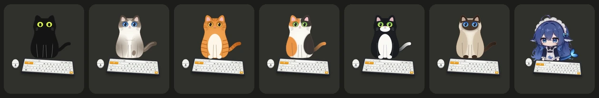

# Deskland Preview

**草原人家，一座会自己过日子的桌面村庄。桌宠，一只会跟着你敲键盘的小伙伴。**

草原人家是随 Windows 桌面图标变化的动态壁纸。边牧带羊群出门，村民在院子里忙活，天黑后有人点起火炬。点一下草地能召来鸟群或流星，拖一个空框还能招来飞碟。独立桌宠会跟着你的键鼠动作，切换壁纸后也能继续陪你。

[鼠标怎么玩](#鼠标怎么玩) · [草原人家](#草原人家) · [桌宠](#桌宠) · [下载与运行](#下载与运行) · [English](#english)



*草原人家分享画面与布偶猫预览合图。示例图标和色块替代真实图标与文件名。*

## 鼠标怎么玩

在 Windows 桌面从**没有图标的位置**开始操作。

| 操作 | 会发生什么 |
| --- | --- |
| **单击空白处** | 白天随机召来鸽群或候鸟，夜里召来流星。快速连点时，候鸟和流星沿同一方向出现，停约 8 秒再点会换方向。设置页的草原人家预览也可以单击。 |
| **按住左键拖一个空框，再松开** | 草地上没框中村庄元素时，飞碟会从随机屏幕角落飞来。地面合适时留下随机图样的怪圈。位置不合适或已有怪圈时，它会悬停察看，冒出逐个增加的省略点，然后从随机屏幕边缘离开。 |
| **框住村庄元素，松手后再点一处空白** | 出现轮廓的元素会一起搬过去。可试试农舍、羊圈、草场、村民、牛羊、狗、火炬、云、飞鸟、蝴蝶或萤火虫。地面元素会尽量找附近可落脚的位置。村民会停下来张望，边牧会去找被移远的羊。框到壁纸元素和桌面图标时，Windows 接管普通图标框选。 |
| **拖动桌面图标** | 图标云与云影平滑跟随，村庄布局和落脚点也会避让图标。 |
| **拖动或右键桌宠** | 拖动调整位置，右键打开 Deskland 设置。开启鼠标穿透时，先按住 **Alt** 再拖动或右键。 |

在「主题 → 草原人家 → 桌面互动」可关闭单击触发效果，框选搬移和空白框选召飞碟仍可用。

## 草原人家

### 村里住着谁

场地足够时，村里有 3 户人家、6 位成人、4 名孩子、3 只家犬、6 只麻雀和 12 头奶牛。羊圈旁还有一只单独负责放牧的边牧，照看 54 只成年羊和 26 只小羊。

| 村庄成员 | 日常 |
| --- | --- |
| **成人** | 会在院里吃饭、浇水、扫地、修理、聊天或去看牛，偶尔也会走远，在开阔草地休息。黄昏会从屋里取来火种照料火炬。 |
| **孩子** | 会放风筝，也会聚在空地玩追逐、传球、排队跟跑和围圈游戏。白天有时躺在草地上休息，夜里也可能和大人一起看极光。 |
| **家犬** | 早上伸懒腰、摇尾迎接家人，白天在院边嗅闻巡游，也会和家人玩捡球、追跑、拔河、呼唤折返。入夜回窝蜷睡。 |
| **麻雀** | 在屋檐筑巢，在屋脊理毛，到草地蹦跳啄食，叼树枝回巢。孩子或狗跑近时，会飞回屋顶。 |
| **奶牛** | 各自觅食，也会跟同伴移动。热时找云影歇息，黄昏往自家附近集合，入夜就地休息。 |
| **边牧与羊群** | 按当地时间 **07:00** 出圈，吃草约 **150 秒**后换到另一片可达的草场，**18:00** 赶羊入圈。边牧会从外侧赶回落单的羊，也能在羊群拥挤时踏过羊背换边。时间滑杆同样能驱动出圈和归圈。 |

[观看边牧出圈、找羊和收圈的实机动画](docs/images/pastoral-herding.webp) · [查看农舍、村民与奶牛的近景](docs/images/pastoral-model-detail.webp)

### 偶发事件

| 事件 | 什么时候会遇到 |
| --- | --- |
| **白鸽来访** | 白天自然出现，也可用空白单击触发。每群 48–72 只，来访约 6–10 分钟，分批落在屋顶和草地，在村里多次起飞、盘旋再离开。同时只来一群。若房屋移走或落脚点被图标占用，它们会从当前位置起飞离场。 |
| **候鸟迁徙** | 白天可能自然飞过，也可用空白单击召来。候鸟从屏幕边缘飞入，偶尔在开阔草地停歇 10–22 秒再继续迁徙。孩子有时会停下来观鸟。 |
| **惊蝶** | 白天偶尔会有孩子或家犬从草地经过，惊起几只蝴蝶。家犬有时会追上前。 |
| **飞碟与怪圈** | 空白拖框可召来飞碟。正常运行时，首次自然来访机会要等约 6–14 小时。飞碟飞在建筑和云层上方。村民要走近才会发现怪圈，接着回家喊帮手、取工具，再逐段耙地播种。草只从实际处理过的地块长回来。 |
| **流星及流星雨** | 入夜后自动出现，也可单击空白触发。有时单颗，有时成双，偶尔出现一场流星雨。白色、青绿、冰蓝、粉紫或琥珀色的光晕会扫过草地，短暂照亮沿途图标。 |



### 从晨光到极光

默认以深圳的城市级参考地点、**17:29** 固定光照和透明任务栏开场。切换「跟随现实时间」后，太阳按所选地点的晨昏变化。也可以拖动时间滑杆，直接看清晨、正午、夕照或蓝紫夜色。固定时刻下，村民和动物仍会继续活动。

入夜后，窗户和火炬亮起，18 只萤火虫在草地闪烁，极光缓慢改变草地、屋顶和云层的色彩。图标云默认透明，云影仍会跟随图标。可以调节云层不透明度、极光与流星光晕的宽度和亮度，也可以单独开关图标受光。



[查看从黎明到夜晚的八组光色对比](docs/images/pastoral-day-cycle.webp)

## 桌宠

**布偶猫是默认伙伴。** 「桌宠」页可以换成经典黑猫、大橘猫、三花猫、奶牛猫、暹罗猫，或大肥鱼 · 鲸鱼娘。桌宠可以独立置顶，跟随键盘按键和鼠标动作，空闲时会打瞌睡。摸摸猫咪的头或背，它会闭眼，快速晃动鼠标还能让它进入捕猎模式。



- **按你的习惯摆放。** 支持 65% 紧凑键盘和 108 键全尺寸键盘，键盘可面向猫咪或观众。大小可调 20%–150%，默认 53%。鼠标穿透、置顶和按键气泡可单独开关，互动音效和呼噜声默认关闭。
- **需要时暂停。** 「暂停监听并隐藏」会停止桌宠的键鼠监听并隐藏角色。密码输入保护默认开启。按键事件在桌宠进程内处理，设置页显示当日击键数和每分钟击键数。
- **定制皮肤。** 可以在设置页修改猫咪的颜色、花纹和斑点，使用新 ID 另存为角色。供 MCP 客户端使用的本地皮肤扩展默认关闭。桌宠和壁纸共用 Deskland 的开机启动开关。

桌宠基于 [qianyiai/KuroCat 4.7.0](https://github.com/qianyiai/kurocat)。[集成说明和第三方许可](third_party/KuroCat/DESKLAND.md)

## 下载与运行

Deskland Preview 是免费的开源体验版，适用于 **64 位 Windows 10 / 11**，需要 **Microsoft Edge WebView2 Runtime**。壁纸覆盖主显示器，以核显 30 fps 为目标。设置支持简体中文和英文，壁纸世界存档、位置设置及桌宠数据保存在本机的 `%LOCALAPPDATA%\DesklandPreview`。

- **体验本文的草原人家与 KuroCat 桌宠**，请从本仓库的当前源码构建。
- **体验已发布的旧版本**。上游 v0.1.3 早于当前草原人家和 KuroCat 桌宠的实现，安装包未签名。 [v0.1.3 Windows 安装包](https://github.com/BLEZZ0102/Deskland/releases/tag/v0.1.3)

### 从源码运行

准备 Windows 自带的 .NET Framework C# 编译器、Node.js 20 或 22+ 与 npm、Rust MSVC 工具链、Visual Studio C++ Build Tools 和 Windows SDK。首次构建需要联网下载依赖。然后在仓库根目录用 PowerShell 执行下列命令。

```powershell
powershell -ExecutionPolicy Bypass -File host\build.ps1
host\bin\Deskland.exe
```

请保持 `host/` 和 `prototype/` 的相对位置。再次运行程序或双击托盘图标进入设置。托盘可暂停、重新载入或退出。也可以运行 `host\bin\Deskland.exe --exit` 退出并恢复 Windows 原壁纸。

需要生成自己的安装包时，运行 `powershell -ExecutionPolicy Bypass -File tools\build-installer.ps1`。安装产物、SHA256 校验及对应源码 ZIP 位于 `dist/`。安装器使用当前用户的 `Programs\Deskland Preview` 目录，卸载会保留设置。

### 浏览器预览与桌面设置

运行 `node prototype\serve.mjs` 后打开本地设置页。浏览器使用示例图标，可试草原人家的空白单击和查看桌宠角色。真实图标适配、桌面空白拖框召飞碟和独立桌宠请使用 Windows 程序。 [本地浏览器预览](http://localhost:5178/settings.html)

设置页可导出图片和动画。分享使用示例图标和色块保护桌面文件名。壁纸支持手动暂停、可选的最大化或全屏暂停，以及默认开启的电池省电模式。

### 其他随附主题

沙滩有海浪、皮划艇、海鸟和椰子树，草地有漂移的云、放风筝的男孩和小黑猫，秋日草地提供麦金色草地和暖白云影。这三个主题也可完整使用，参数独立保存。带锁主题提供名称、简介、缩略图和购买说明。

### 来源、许可与反馈

本仓库由 rhouselyn 独立维护，基于 BLEZZ0102 的 Deskland 继续开发，保留原作者署名。项目源码和随附主题素材按 GPL-3.0 发布。 [上游项目](https://github.com/BLEZZ0102/Deskland) · [GPL-3.0](LICENSE) · [第三方许可](THIRD_PARTY_NOTICES.md) · [名称与图标使用说明](TRADEMARKS.md) · [反馈问题或建议](https://github.com/rhouselyn/Deskland/issues)

---

## English

**Meadow Village is a living Windows wallpaper. The desktop pet is your companion while you type.** Your icons shape the scenery around them. Watch a collie herd sheep, villagers go about their day and torches light up after sunset. Use your mouse to call birds, meteors or a flying saucer. The separate pet can stay on top while you work or switch wallpapers.


### Mouse controls

| Gesture | What happens |
| --- | --- |
| **Click empty desktop space** | Call a pigeon flock or migrating birds by day, or meteors by night. Quick repeat clicks send migrants and meteors in the same direction. Wait about eight seconds for a new direction. The Meadow Village settings preview also supports clicks. |
| **Drag an empty selection box and release** | A saucer flies in from a random corner. It draws a crop circle on suitable open ground. If the site is unsuitable or a circle already exists, it hovers with a growing thought bubble and flies away. |
| **Box-select scenery, then click a new spot** | Move the outlined objects together. Try houses, the sheepfold, grazing fields, people, animals, torches, clouds, birds, butterflies or fireflies. Residents pause and look around, and the collie searches for relocated sheep. Windows handles the marquee when it covers both scenery and desktop icons. |
| **Move a desktop icon** | The clouds and their shadows shift with it, while buildings and landing spots make room. |
| **Drag or right-click the pet** | Drag to reposition it or right-click to open Deskland settings. With click-through on, hold **Alt** to do either. |

The **Desktop interaction** setting controls ordinary click effects. Marquee selection and saucer summoning still work when those effects are off.

### Meadow Village

When space permits, the village has three households with six adults, four children, three family dogs, six sparrows and twelve cows. A separate border collie tends 54 adult sheep and 26 lambs. It takes them out at **07:00**, moves them to another reachable pasture after about 150 seconds of grazing and brings them back at **18:00** local time. It circles behind strays and can cross over the flock when sheep bunch together. The time slider can trigger both departures and returns.

- **Adults and children** eat, do chores, visit the cows, go on long walks and rest on the grass. Children fly kites and play tag, pass the ball, run in a line or gather in a circle. At night, villagers sometimes come back outside to watch the aurora.
- **Family dogs** stretch, greet their families, roam, play fetch, chase, tug and recall games, and curl up in their kennels at night.
- **Sparrows** tend their nests, preen on the roof, peck on the lawn and bring back twigs. Children or dogs can startle them back onto the roof.
- **Cows** graze, follow companions, rest in cloud shade and gather near home as evening approaches.

[Watch the border collie in action](docs/images/pastoral-herding.webp) · [See the village models close up](docs/images/pastoral-model-detail.webp)

| Event | What to watch for |
| --- | --- |
| **Pigeon flock** | A visit can start naturally in daylight or from a desktop click. One flock of 48–72 birds visits at a time, typically for 6–10 minutes. It circles and lands in groups on roofs and lawns. Moving a house or occupying a landing spot with an icon can send the flock away. |
| **Migration and butterflies** | Migrants can rest on an open lawn for 10–22 seconds before continuing. Children sometimes stop to watch birds. A child or family dog crossing the grass can occasionally startle butterflies into flight. |
| **Saucer and crop circle** | Summon one with an empty marquee, or watch for the first natural visit after about 6–14 hours of active simulation. A villager must get close enough to spot a circle, then recruits helpers and brings tools. They rake and sow each patch, and the grass regrows where they worked. |
| **Meteors and showers** | Single, paired and occasional shower events sweep the grass and nearby icons with white, teal, icy blue, pink-violet or amber light. |

The default uses a **17:29** fixed clock, a city-level Shenzhen reference location and a transparent taskbar. Switch to local solar time or drag the clock slider to explore eight daylight palettes. At night, windows and torches glow, eighteen fireflies appear and the aurora moves across the grass, roofs and clouds. Icon clouds start transparent while their shadows remain visible. Cloud opacity, icon lighting and the width and brightness of aurora and meteor glow are adjustable.

[See the saucer drawing a crop circle](docs/images/pastoral-ufo.webp) · [Compare dawn through moonlight](docs/images/pastoral-day-cycle.webp)

### Desktop pet

Choose from **Black Cat, Ragdoll, Orange Tabby, Calico, Tuxedo, Siamese and BigFish**. The pet reacts to typing and mouse movement, dozes when idle, closes its eyes when petted and enters hunting mode when you shake the mouse quickly. The default is a silent, click-through Ragdoll at 53% size.


The **Pets** tab includes compact 65% and full-size 108-key keyboards, two keyboard orientations, 20–150% sizing, topmost and click-through controls, key bubbles, sound and purring. The password input guard is on by default. **Pause input and hide** suspends the pet and its input hooks. Customize cat skins locally or enable the optional MCP skin integration, which starts off. The pet is based on [qianyiai/KuroCat 4.7.0](https://github.com/qianyiai/kurocat). [Integration and license notes](third_party/KuroCat/DESKLAND.md)

### Download and build

Deskland Preview is free and open source. It requires **64-bit Windows 10 or 11** and **Microsoft Edge WebView2 Runtime**, runs the wallpaper on the primary monitor and targets 30 fps on integrated graphics. The app supports English and Simplified Chinese. Location, world saves and pet settings are stored locally under `%LOCALAPPDATA%\DesklandPreview`.

Build the current source to try the village and KuroCat pet featured here. The upstream v0.1.3 installer is unsigned and predates these implementations. [Upstream v0.1.3 Windows installer](https://github.com/BLEZZ0102/Deskland/releases/tag/v0.1.3)

With the Windows .NET Framework C# compiler, Node.js 20 or 22+ and npm, Rust MSVC, Visual Studio C++ Build Tools and a Windows SDK, run the following from the repository root. The first build downloads dependencies.

```powershell
powershell -ExecutionPolicy Bypass -File host\build.ps1
host\bin\Deskland.exe
```

Keep `host/` and `prototype/` together. Run the app again or double-click its tray icon to open Settings. Use the tray menu or `host\bin\Deskland.exe --exit` to quit and restore the system wallpaper. To package a per-user Windows installer with checksums and a matching source ZIP, run `powershell -ExecutionPolicy Bypass -File tools\build-installer.ps1`.

For a browser preview, run `node prototype\serve.mjs` and open the local settings page. Use the Windows host for real icon adaptation, desktop marquee summoning and the independent pet. Image and animation sharing replace real icons and file names with sample graphics. The app also offers tray pause, optional pause for maximized or full-screen windows and a battery saver that is on by default. [Local settings page](http://localhost:5178/settings.html)

**Also included** are Beach, Meadow and Autumn Meadow, each with its own saved settings. Locked theme cards contain names, descriptions, thumbnails and purchase information.

This is rhouselyn's independent community continuation of BLEZZ0102's Deskland, released under GPL-3.0. [Upstream project](https://github.com/BLEZZ0102/Deskland) · [GPL-3.0](LICENSE) · [Third-party notices](THIRD_PARTY_NOTICES.md) · [Name and icon guidelines](TRADEMARKS.md) · [Report an issue or share feedback](https://github.com/rhouselyn/Deskland/issues)
