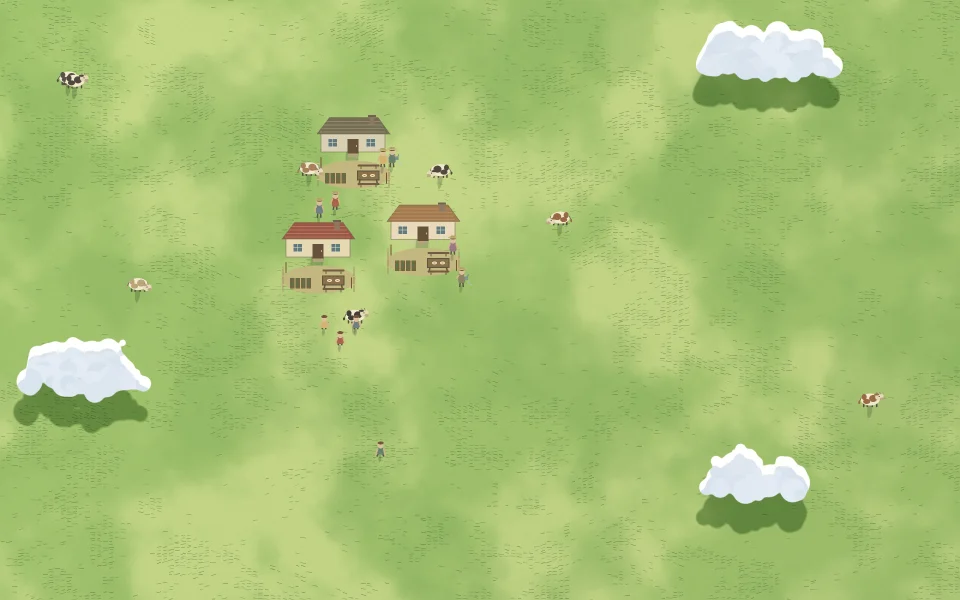
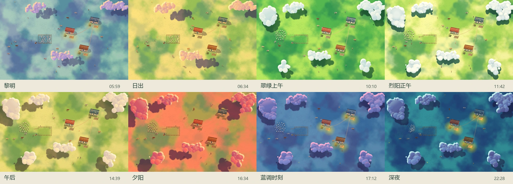

# Deskland Preview

**Adaptive Windows wallpaper that makes your desktop icons part of the scenery.**

Deskland turns the space around your icons into a living landscape. Move, add or remove an icon and the beach, meadow, clouds and shadows quietly reshape around it — in real time, without AI, an account or an API key.

This is the **free, open-source Preview**, not a time-limited trial. It includes the complete **Beach**, **Meadow**, **Autumn Meadow** and **Meadow Village** themes, the Windows host, settings and sharing tools.

**English** · [简体中文](#中文说明) · [Official website](https://deskland.app) · [Features](#features) · [Build from source](#build-from-source)




Meadow, Beach and Autumn Meadow are included in Preview. Maldives is shown as a locked-theme preview.

Autumn Meadow adds wheat-gold grass, warm clouds and autumn shadows, with independent saved settings.

A border collie takes 54 adult sheep and 26 lambs out at 07:00 local time, moves to a distant reachable patch of grass after about 150 seconds of grazing and brings them back at 18:00. When the flock packs tightly, the collie can run across the sheep’s backs to change sides. Meadow Village also has independent cows and families, safe house placement, children’s games, local sunrise/sunset and torchlit nights. Eight daylight palettes distinguish rosy dawn, emerald mornings, sun-bleached noon highlights, coral sunset, blue hour and silver-blue moonlight, with warm windows, 18 fireflies and a soft auroral glow that shifts across the grass, roofs and clouds throughout the night. Adults and children sometimes lie on the grass to watch the lights or rest there by day. Single meteors, pairs and occasional showers gradually cast broad glows that briefly light nearby icons. About one in five is white, with blue-green, icy blue, pink-violet and amber making up the rest. Icon clouds are hidden by default while their shadows follow the icons. In Settings, you can adjust their opacity from 0% to 100% and toggle icon lighting independently. The default view uses 17:29 with a city-level Shenzhen reference location, a transparent taskbar and the saved lighting preset. You can switch to real time and set a different location. Personal coordinates and world saves stay on this PC.

An empty desktop marquee calls a saucer. It draws a random crop circle on suitable ground, or inspects the site with a growing dot bubble and leaves. Villagers occasionally take long walks, discover circles only when nearby, fetch helpers and tools, then rake and sow each patch. Grass returns where they actually worked.

## Included themes

The **Pets** tab integrates qianyiai/KuroCat 4.7.0 as an independent desktop pet: six cats (an enabled, silent, click-through ragdoll at 53% size by default) plus BigFish, 65%/108-key layouts, two keyboard directions, 20–150% sizing, sound, password input protection, click-through, pause/hide and custom skins. Optional MCP skin tools are off by default. Settings and pet data stay under the Preview data directory. Automatic updates and the separate upstream tray/startup entry are removed. Source and MIT licenses: `third_party/KuroCat`.

| Beach | Meadow |
| --- | --- |
|  |  |
| Turquoise waves, kayaks, seabirds and coconut palms. | Drifting clouds and shadows, a boy flying a kite and a little black cat. |

The theme browser also shows 11 locked themes as a preview of the full Wallpaper edition. **Only names, descriptions and thumbnails are included for those themes — not their page code, parameters or implementation.**

## Features

- **Adaptive scenery:** uses the real positions of desktop icons and transitions smoothly when they move.
- **Four complete themes:** every setting for Beach, Meadow, Autumn Meadow and Meadow Village is included and saved between sessions.
- **Made for the desktop:** tray controls, startup on sign-in and automatic pause when a window is maximized or full-screen.
- **Private sharing:** image and animation exports use sample icons and color blocks, never a screenshot of your desktop or real file names.
- **Independent installation:** Preview uses its own install directory, settings, startup entry and instance identity, so it can coexist with other Deskland builds.
- **English and Simplified Chinese:** no sign-in, purchase restoration, update service or store API is included.

## Requirements

- Windows 10 or Windows 11, 64-bit.
- Microsoft Edge WebView2 Runtime.
- PowerShell and the .NET Framework C# compiler included with Windows; no .NET SDK installation is required.
- Node.js 20 or 22+, the Rust MSVC toolchain, Visual Studio C++ Build Tools and a Windows SDK to build the desktop pet.
- An internet connection for the first build, which downloads the WebView2 development library.
- Node.js only if you want to run the browser preview.

Currently, Deskland renders on the **primary monitor** and targets 30 fps on integrated graphics.

## Build from source

Open PowerShell in the repository root:

```powershell
powershell -ExecutionPolicy Bypass -File host\build.ps1
host\bin\Deskland.exe
```

Keep `host/` and `prototype/` together. Build output is written to `host/bin/`.

Run the program again or double-click its tray icon to open Settings. To exit and restore the original Windows wallpaper, use the tray menu or run:

```powershell
host\bin\Deskland.exe --exit
```

Preview settings and logs are stored separately in `%LOCALAPPDATA%\DesklandPreview`.

## Browser preview

```powershell
node prototype\serve.mjs
```

Open **http://localhost:5178/settings.html**. The browser uses sample icons; adaptation to real desktop icons requires the Windows host.

## Windows installer

Build the NSIS installer without installing global development tools:

```powershell
powershell -ExecutionPolicy Bypass -File tools\build-installer.ps1
```

The first build downloads portable NSIS and Microsoft's WebView2 bootstrapper. Artifacts are written to `dist/` with SHA256 checksums and a matching source ZIP.

The installer targets the current user's `Programs\Deskland Preview` directory and does not require administrator rights. If WebView2 is missing, its bootstrapper requires an internet connection. Uninstalling preserves user settings.

[Download Deskland Preview for Windows](https://github.com/BLEZZ0102/Deskland/releases/latest). The installer is unsigned, so Windows SmartScreen may show a warning.

## Project layout

| Path | Contents |
| --- | --- |
| `host/` | Windows host, build scripts and application manifest |
| `prototype/flat.html` | Beach theme |
| `prototype/meadow.html` | Meadow theme |
| `prototype/pastoral.html` | Meadow Village theme |
| `prototype/settings.html` | Settings interface |
| `prototype/themes.json` | Full free-theme definitions and locked-theme display metadata |
| `prototype/share.js` | Privacy-preserving image and animation sharing |
| `prototype/assets/` | Images used by the included themes |
| `tools/` | Installer build tooling |

## Known limitations

- Only the primary monitor is supported.
- Windows Spotlight or a wallpaper slideshow can briefly flash when Windows changes the background image.
- Preview does not include account sign-in, entitlement restoration, automatic updates or the other themes' implementation.

## Credits and license

Source code and included theme assets are released under [GPL-3.0](LICENSE). Third-party dependencies are listed in [THIRD_PARTY_NOTICES.md](THIRD_PARTY_NOTICES.md).

The Deskland name and icon are not licensed as trademarks; modified distributions should use their own name and icon. See [TRADEMARKS.md](TRADEMARKS.md).

Issues and suggestions are welcome through GitHub Issues. This is an independent project, so immediate responses are not guaranteed.

---

## 中文说明

[English](#deskland-preview) · **简体中文**

**让桌面图标成为风景的一部分。**

Deskland 是一款 Windows 自适应动态壁纸。移动、添加或删除桌面图标时，海岸线、草地、云朵和阴影会实时围绕图标调整。全部在本地实时演算，不使用 AI，无需账号或 API Key。

本仓库是**免费的开源体验版，不是限时试用版**，包含完整的沙滩、草地、秋日草地和草原人家主题、Windows 宿主、设置界面与分享工具。

[官方网站](https://deskland.app) · [从源码运行](#build-from-source) · [许可](#credits-and-license)

秋日草地提供麦金色草地、暖白云团和秋日云影，参数独立保存。

草原人家最多有 12 头牛。边牧每天按当地时间 07:00 带 54 只成年羊和 26 只小羊出圈，每吃约 150 秒换到远处的草地，途中绕过房屋，可以经过图标，草场中心避开图标。羊群密集时，边牧可以踩着羊背换边。落单的羊由它绕到外侧赶回，18:00 收群入圈后回到圈边的狗窝。时间滑杆也能驱动这套作息。村里还有家庭与儿童游戏，房屋避让图标，按真实地点计算晨昏并在夜间点亮火炬。入夜后有 18 只萤火虫，整夜的极光以柔和的环境光映在草地、屋顶和云层上，色彩和明暗随时间缓缓起伏。大人和孩子有时会出门躺在草地上看极光，白天也会躺下休息。流星有时单颗掠过，有时两颗相随，偶尔形成流星雨。约两成流星为白色，其余为青绿、冰蓝、粉紫或琥珀色。宽光晕逐渐扫入画面，短暂照亮沿途的图标。图标下的云默认隐藏，云影仍跟随图标。设置中可在 0% 到 100% 之间调节图标云层的不透明度，也可以单独开关图标受光。默认打开草原人家，使用深圳城市级参考地点的固定 17:29 光照、透明任务栏和当前灯光预设。可切换到现实时间，或在设置中定位、填写其他地点。个人地点与世界存档保存在本机，最大化或全屏时暂停默认关闭。

左键单击草原人家的桌面或设置预览中的空白处，可以让一次自然事件立即开始。白天随机触发鸽群或候鸟，从屏幕边缘飞入。候鸟偶尔在开阔草地停歇 10～22 秒后继续迁徙。鸽群以白鸽为主，每群 48～72 只，独立选择方向，一次来访约 6～10 分钟。它们分批在屋顶和草地落脚，多次起飞并在村庄不同位置盘旋，最后飞出屏幕。房屋搬移或落脚点被图标占用时，鸽群会从当前位置起飞离场。同时只出现一群，已有鸽群时忽略额外的鸽群触发。白天也会自然出现鸽群。入夜后，流星按当前设置掠过村庄。候鸟和流星在连续点击时沿用同一方向，停点 8 秒后再次点击会换向。

空白框选会召来飞碟，合适的地面会留下一个随机怪圈；已有怪圈或地点不合适时，飞碟会察看、冒出逐个增加的省略点，然后离开。村民偶尔远行，走近怪圈才会发现，再回家找帮手、取工具并逐段耙地播种，草从实际处理的位置长回。

从空白处按住左键拖框，松开后选中的元素会出现轮廓。再单击另一处空白，选中的房屋、居民或动物会一起移到那里。村民会停下来四下张望，边牧会去找被移远的羊。落点被占用时，地面元素会寻找邻近的可用位置。「桌面互动」里的开关控制普通单击触发的自然事件，关闭后仍可框选搬移。

草原人家用同一套斜俯视比例绘制农舍、村民和牛群。成人约 1.73 米，孩子约 1.12 米，门框高 2.08 米。红瓦屋有门廊，灰瓦屋有老虎窗，赭瓦屋的窗下种着花。

[观看边牧放牧、找羊和收圈的实机动画](docs/images/pastoral-herding.webp)

时间滑杆可固定时刻，也可跟随当地太阳。黎明的桃粉云边逐渐变成杏金色，上午保留翠绿草地，正午则有柠檬黄绿的草尖、亮白的云顶，以及更短、更清晰的青绿投影。午后斜光染上麦金色，夕照在草地上留下珊瑚红反光。入夜后，蓝紫云影、银蓝云边和院内的火炬让村庄依然可见。



### 包含的主题

“桌宠”页已替换为 qianyiai/KuroCat 4.7.0，独立显示在应用窗口上方。支持六种猫咪与大肥鱼，默认开启 53% 大小的布偶猫、静音和鼠标穿透、65%/108 键、正反朝向、20%–150% 大小、音效、密码输入保护、穿透、暂停隐藏及自定义皮肤。MCP 皮肤扩展默认关闭。开机启动统一使用 Deskland 开关，不接入原项目自动更新。旧设置在迁移前备份，超出新版范围的大小限制到 150%。源码与角色素材的 MIT 许可位于 `third_party/KuroCat`。编译还需要 Node.js 20 或 22+、Rust MSVC 工具链、Visual Studio C++ Build Tools 与 Windows SDK。

| 沙滩 | 草地 |
| --- | --- |
|  |  |
| 海浪、皮划艇、海鸟和椰子树。 | 漂浮的云与云影、放风筝的男孩和小黑猫。 |

主题列表还展示另外 11 个锁定主题，帮助了解壁纸版内容。**这些锁定主题只有名称、简介和缩略图，不包含页面源码、参数或其他实现。**

### 功能

- **图标自适应：**读取真实桌面图标的位置，在移动、添加或删除时平滑调整场景。
- **四个完整主题：**沙滩、草地、秋日草地和草原人家的全部参数均可调整并自动保存。
- **适合常驻桌面：**托盘控制、开机自动启动，前台窗口最大化或全屏时自动暂停。
- **隐私分享：**图片和动画使用示例图标与名字色块，不截取桌面窗口或真实文件名。
- **独立安装：**安装目录、用户数据、启动项和运行实例标识均独立，可与其他 Deskland 版本共存。
- **简体中文和英文：**不包含登录、购买恢复、自动更新或商店接口。

### 系统要求

- Windows 10 / Windows 11，64 位。
- Microsoft Edge WebView2 Runtime。
- 使用 Windows 自带的 .NET Framework C# 编译器，无需安装 .NET SDK。
- 第一次构建需要联网下载 WebView2 开发库。
- 仅浏览器预览需要 Node.js。

目前只覆盖**主显示器**，以核显 30fps 为目标。

### 从源码运行

在仓库根目录打开 PowerShell：

```powershell
powershell -ExecutionPolicy Bypass -File host\build.ps1
host\bin\Deskland.exe
```

请保持 `host/` 和 `prototype/` 的相对目录结构，编译结果位于 `host/bin/`。

再次运行程序或双击托盘图标可打开设置。退出并恢复系统原壁纸，请使用托盘菜单或执行：

```powershell
host\bin\Deskland.exe --exit
```

体验版的设置与日志独立保存在 `%LOCALAPPDATA%\DesklandPreview`。

### 浏览器预览

```powershell
node prototype\serve.mjs
```

打开 **http://localhost:5178/settings.html**。浏览器使用示例图标，真实桌面图标适配需要 Windows 宿主。

### Windows 安装包

```powershell
powershell -ExecutionPolicy Bypass -File tools\build-installer.ps1
```

首次构建会下载便携版 NSIS 和微软 WebView2 引导程序，无需安装全局开发工具。产物位于 `dist/`，附 SHA256 校验文件和对应源码 ZIP。

安装包安装到当前用户的 `Programs\Deskland Preview` 目录，无需管理员权限。缺少 WebView2 时需要联网安装；卸载保留用户设置。

[下载 Deskland Preview Windows 安装包](https://github.com/BLEZZ0102/Deskland/releases/latest)。安装包未签名，Windows SmartScreen 可能显示提示。

### 目录结构

| 路径 | 用途 |
| --- | --- |
| `host/` | Windows 宿主、构建脚本与清单 |
| `prototype/flat.html` | 沙滩主题 |
| `prototype/meadow.html` | 草地主题 |
| `prototype/pastoral.html` | 草原人家主题 |
| `prototype/settings.html` | 设置界面 |
| `prototype/themes.json` | 免费主题完整定义及锁定主题展示信息 |
| `prototype/share.js` | 隐私保护的图片和动画分享 |
| `prototype/assets/` | 随附主题图片素材 |
| `tools/` | 安装包构建工具 |

### 已知限制

- 目前只支持主显示器。
- 使用 Windows 聚焦或壁纸幻灯片时，系统换图可能造成短暂闪烁。
- 体验版不包含账号登录、购买恢复、自动更新或其他主题实现。

### 许可与反馈

项目源码和随附主题素材按 [GPL-3.0](LICENSE) 发布，第三方依赖见 [THIRD_PARTY_NOTICES.md](THIRD_PARTY_NOTICES.md)。

Deskland 名称与图标不作为商标授权授予；修改版应使用自己的名称和图标，详见 [TRADEMARKS.md](TRADEMARKS.md)。

欢迎通过 GitHub Issues 反馈问题和建议。个人项目，不保证即时回复。
